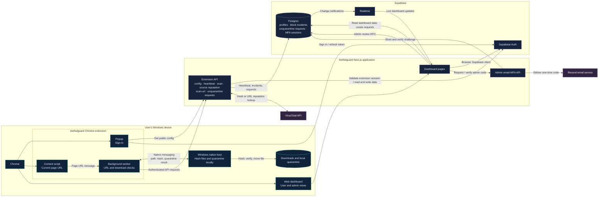

# Aethelguard System Architecture

This is the maintained high-level architecture diagram for the project. Update
it when a client, server boundary, external service, or data flow changes.

## Important data boundaries

- The native host calculates file hashes and moves quarantined files on the
  Windows device. File contents are not uploaded to Aethelguard or VirusTotal.
- The extension sends a file hash to the Aethelguard API for a VirusTotal
  report. A block incident is recorded only after the native host confirms
  quarantine.
- URL reputation checks use the Aethelguard API and VirusTotal; submitting an
  unknown URL for analysis shares that URL with VirusTotal.
- Supabase Auth handles account and extension sessions. The dashboard reads
  user-scoped data; administrator actions are enforced by database functions
  and policies. Realtime publishes updates to connected dashboards.
- The service-role key, VirusTotal API key, and Resend API key stay on the
  server.
